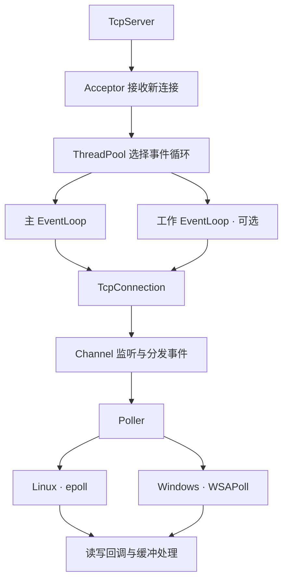

# 🌙 DreamNet

**C++23 · Reactor · epoll · WSAPoll · CMake**

DreamNet 是一个面向 Linux 和 Windows 的 TCP 网络库。通过事件循环驱动非阻塞 I/O，以回调组织连接建立、消息接收与数据发送，并提供工作线程池、定时任务和客户端自动重连。

从一个 Echo 服务开始，也可以在其上实现自己的应用层协议。✨

## ✨ 项目特性

- 🔄 **Reactor 模型**：以 `EventLoop` 为中心，统一管理 I/O 事件、待执行任务与定时任务。
- 🐧 **Linux 支持**：使用 epoll 监听事件，eventfd 实现跨线程唤醒，timerfd 驱动定时器。
- 🪟 **Windows 支持**：使用 WSAPoll 监听 Socket，本地 UDP Socket 实现唤醒，通过轮询超时调度定时任务。
- 🧵 **可选工作线程池**：主循环接收新连接，根据事件循环当前监听的句柄数量选择工作循环。
- 📡 **TCP 服务端与客户端**：支持连接回调、消息回调、服务端广播，以及客户端连接失败和非主动断开后的自动重连。
- 📦 **收发缓冲**：自动扩容、保留未消费数据，支持 `std::span`、`std::string_view` 和缓冲高水位回调。
- ⏱️ **任务调度**：支持跨线程投递任务，以及毫秒、秒级的一次性延迟任务。
- 🔌 **CMake 集成**：提供 `Dream::Net` 目标，支持源码引用、动态库安装与 `find_package`。

## 🧩 Reactor 架构



每个事件循环由一个线程执行。默认情况下，服务端在主循环中接收连接并处理 I/O；调用 `setThreadCount()` 后，主循环负责接收连接，工作循环负责连接的 I/O。

业务回调在连接所属的事件循环线程执行。耗时计算或阻塞操作应交 给业务线程，再通过 `runInLoop()` 或 `queueInLoop()` 将后续操作投递回来。

公共接口位于 `include/DreamNet/`，内部实现位于 `include/tcp/`、`include/common/` 和对应的 `src/` 目录。

## 🚀 编译

### 🧰 环境要求

| 项目 | 要求 |
| --- | --- |
| CMake | 3.21 或更高版本 |
| C++ | 支持 C++23 的编译器及标准库，包含 `std::format`、`std::print` 和 `std::chrono` 时区功能 |
| Windows | 本机已使用 Visual Studio 2026、Windows SDK 和 x64 配置验证 |
| Linux | 支持 epoll、 eventfd 和 timerfd 的 Linux 环境 |

以下命令均在项目根目录执行，默认会构建动态库与 examples。

### 🪟 Windows

```powershell
cmake -S . -B build/windows -G "Visual Studio 18 2026" -A x64
cmake --build build/windows --config Debug --parallel
```

构建 Release 版本：

```powershell
cmake --build build/windows --config Release --parallel
```

CMake 会链接 `ws2_32`，并将 examples 需要的 `DreamNet.dll` 复制到可执行文件所在目录。

### 🐧 Linux

```sh
cmake -S . -B build/linux -DCMAKE_BUILD_TYPE=Release
cmake --build build/linux --parallel
```

### ⚙️ 构建选项

| 选项 | 默认值 | 说明 |
| --- | --- | --- |
| `DREAM_BUILD_EXAMPLES` | `ON` | 构建 `echoServer` 和 `echoClient` |
| `DREAM_BUILD_TESTS` | `OFF` | 构建本地集成测试，需要工作区中存在 `tests/` 目录 |

只构建库时，可以在配置命令中添加 `-DDREAM_BUILD_EXAMPLES=OFF`。

## 🎮 运行 Echo 示例

示例默认连接到 **`127.0.0.1:11451`**。打开两个终端，先启动服务端，再启动客户端。

### 🪟 Windows

服务端终端：

```powershell
./build/windows/examples/Debug/echoServer.exe
```

客户端终端：

```powershell
./build/windows/examples/Debug/echoClient.exe
```

### 🐧 Linux

服务端终端：

```sh
./build/linux/examples/echoServer
```

客户端终端：

```sh
./build/linux/examples/echoClient
```

客户端输入一行文字并回车，即可收到服务端回显：

```text
Connection established: 127.0.0.1
hello DreamNet!
recv: hello DreamNet!
```

客户端收到标准输入 EOF 后退出：Windows 控制台可按 `Ctrl+Z` 后回车，Linux 可按 `Ctrl+D`。服务端可通过 `Ctrl+C` 停止。

## 📝 快速上手

### 🖥️ 一个最小 Echo 服务端

```cpp
#include <DreamNet/DreamNet.h>

int main() {
    Dream::EventLoop loop;
    Dream::TcpServer server(&loop, Dream::Address(11451));

    // 可选：在 start() 前设置工作线程数。
    server.setThreadCount(2);
    server.setMessageCallback([](Dream::TcpConnectionPtr conn, const Dream::Buffer& buffer) {
        conn->send(buffer);
        return static_cast<uint32_t>(buffer.readableSize());
    });

    server.start();
    loop.loop();
}
```

### 💬 一个主动发送消息的客户端

```cpp
#include <DreamNet/DreamNet.h>

#include <print>
#include <string_view>

int main() {
    Dream::EventLoop loop;
    Dream::TcpClient client(&loop, Dream::Address(11451));

    client.setConnectionCallback([](Dream::TcpConnectionPtr conn) {
        if (conn->isConnected()) {
            constexpr std::string_view message = "Hello from DreamNet!\n";
            conn->send(message.data(), message.size());
        }
    });
    client.setMessageCallback([](Dream::TcpConnectionPtr conn, const Dream::Buffer& buffer) {
        std::print("recv: {}", buffer.getView());
        return static_cast<uint32_t>(buffer.readableSize());
    });

    client.connect();
    loop.loop();
}
```

完整的交互式客户端见 [examples/echoClient.cpp](examples/echoClient.cpp)，服务端见 [examples/echoServer.cpp](examples/echoServer.cpp)。

### 📬 消息消费与拆包

`MessageCallback` 的返回值表示本次已消费的字节数。库会从接收缓冲中移除这些字节，并保留其余数据；协议帧尚未收齐时，可以返回 `0`，等待后续数据。

TCP 提供字节流，一次消息回调可能包含半条消息或多条消息。上面的 Echo 示例直接消费全部数据；实现应用层协议时，需要根据长度字段、分隔符等规则自行拆包。

`Buffer::peek()` 和 `Buffer::getView()` 返回内部数据的视图。若需要在回调结束后异步使用数据，应先复制到自己管理的存储中。

## 🛠️ 常用接口

| 类型 | 职责与常用接口 |
| --- | --- |
| `EventLoop` | `loop()`、`quit()`、`runInLoop()`、`queueInLoop()`、`runAfter()` |
| `TcpServer` | `start()`、`setThreadCount()`、`sendBroadcast()` 和业务回调设置 |
| `TcpClient` | `connect()`、`disconnect()`、`send()`、`setRetryInterval()` |
| `TcpConnection` | `send()`、`shutdown()`、`close()`、连接状态与本地/远端地址查询 |
| `Address` | IPv4 地址与端口封装，默认 IP 为 `127.0.0.1` |
| `Buffer` | `write()`、`peek()`、`read()`、`consume()`、`compact()`、`getView()` |

`runInLoop()` 在当前线程属于目标循环时直接执行任务，否则入队并唤醒循环；`queueInLoop()` 始终将任务放入待执行队列。`runAfter()` 用于一次性延迟调用，支持 `std::chrono::milliseconds` 和 `std::chrono::seconds`。

客户端可通过 `setRetryInterval()` 设置重试基础间隔，单位为毫秒。连接失败后的等待时间随重试次数线性增加，最大为 30 秒，成功连接后重置计数。

## 🌍 跨平台实现

| 能力 | 🐧 Linux | 🪟 Windows |
| --- | --- | --- |
| 事件轮询 | epoll | WSAPoll |
| I/O 触发方式 | 边缘触发 | 电平触发 |
| 跨线程唤醒 | eventfd | 本地互连 UDP Socket |
| 定时任务 | timerfd | 根据最近到期时间计算轮询超时 |
| Socket 句柄 | `int` | 原生 `SOCKET`，保留完整位宽 |
| 错误获取 | `errno` | `WSAGetLastError()` |
| 动态库符号 | 默认导出机制 | `DREAM_NET_API` 导入、导出 |

平台由 CMake 自动选择。链接 `Dream::Net` 后，使用方会继承 `PLATFORM_LINUX` 或 `PLATFORM_WINDOWS`，无需另外定义。

Windows 的 Winsock 初始化与清理由库管理。公共类型差异集中在 [socketTypes.h](include/DreamNet/socketTypes.h)，导出定义集中在 [define.h](include/DreamNet/define.h)；Socket 操作、错误处理与唤醒机制封装在内部实现中。

WSAPoll 不提供 epoll 的边缘触发语义，Windows 后端不会将 `EVENT_ET` 映射为原生事件，两端均持续读写到 would-block。Windows 的连接失败事件通知依赖 Windows 10 2004 起的行为，详见 [Microsoft WSAPoll 文档](https://learn.microsoft.com/en-us/windows/win32/api/winsock2/nf-winsock2-wsapoll)。

## 📦 安装与 CMake 引用

### 🔗 直接引用源码

```cmake
add_subdirectory(path/to/DreamNet)
target_link_libraries(yourApp PRIVATE Dream::Net)
```

### 📥 安装到指定目录

Windows：

```powershell
cmake --install build/windows --config Debug --prefix ./build/install
```

Linux：

```sh
cmake --install build/linux --prefix "$PWD/build/install"
```

### 🧱 使用安装后的库

在应用程序的 `CMakeLists.txt` 中引用：

```cmake
cmake_minimum_required(VERSION 3.21)
project(YourApp LANGUAGES CXX)

find_package(Dream REQUIRED COMPONENTS Net)

add_executable(yourApp main.cpp)
target_link_libraries(yourApp PRIVATE Dream::Net)
```

配置应用程序时，将 `CMAKE_PREFIX_PATH` 指向安装目录的绝对路径。`Dream::Net` 会传递公共头文件路径、C++23 要求和平台宏。

Windows 下，运行应用程序时还需要将安装目录中的 `bin/DreamNet.dll` 放到应用程序目录，或将该 `bin` 目录加入 `PATH`。库与应用程序应使用匹配的 Debug / Release 配置。

## ✅ 验证记录

已在 Windows、VS2026 x64 环境中完成以下验证，Debug 与 Release 均通过：

| 验证项 | 内容 |
| --- | --- |
| 🎮 examples 联调 | 实际启动服务端和客户端，验证三条消息回显，包含一条 8192 字节消息，客户端 EOF 后正常退出 |
| 🧵 跨线程唤醒 | 四个线程共投递 2048 个任务，检查任务执行数量与线程归属 |
| ⏱️ 定时任务 | 在其他线程添加较早到期的任务，检查循环唤醒与执行时间 |
| 📡 多连接回显 | 两个服务端工作线程，三个客户端各发送并核对 4 MiB 二进制数据 |
| 🔄 失败重连 | 客户端先发起连接，服务端延迟启动，检查后续连接与回显 |

另已验证 Release 安装包可由独立 CMake 项目通过 `find_package(Dream REQUIRED COMPONENTS Net)` 引用并运行。

若本地保留了 `tests/` 目录，可在配置时启用 `-DDREAM_BUILD_TESTS=ON`，构建后运行：

```powershell
ctest --test-dir build/windows -C Debug --output-on-failure
./tests/runExamples.ps1 -BuildDirectory ./build/windows -Configuration Debug
```

集成测试使用端口 `31451`、`31452`，Echo 示例使用端口 `11451`。目前的实机验证记录来自 Windows，Linux 分支尚未在本轮修改中运行验证。

## 🗂️ 目录结构

```text
DreamNet/
├── cmake/                 # CMake 安装包配置
├── examples/              # Echo 服务端与交互式客户端
├── include/
│   ├── DreamNet/          # 对外接口、Buffer 与平台类型定义
│   ├── common/            # Socket、唤醒、日志与并发队列
│   └── tcp/               # Reactor、连接、线程池与定时器内部声明
├── src/
│   ├── DreamNet/          # 对外接口实现
│   ├── common/            # 平台相关的基础设施实现
│   └── tcp/               # Reactor 与 TCP 内部实现
├── CMakeLists.txt
└── LICENSE
```

## 📜 开源协议

本项目采用 [GNU General Public License v3.0](LICENSE)。
